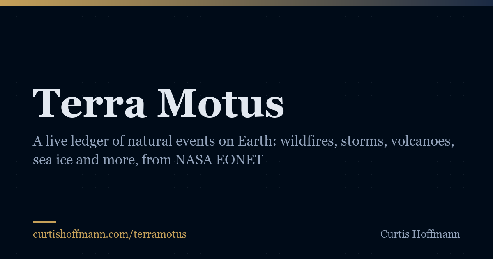

# Terra Motus

Natural events on Earth in the last 30 days, from NASA's Earth Observatory Natural Event Tracker (EONET), as one plain table that refreshes itself every six hours.

Live at **https://curtishoffmann.com/terramotus/**



## What it does

- **One row per event.** Date of the most recent observation, category, event name linked to the source agency's report, size (burned area, wind speed or ice area where EONET records one), number of observations, and the position of the latest observation. Newest first.
- **Search, filter, sort.** A labeled search box, one button per category with its count, and sortable columns. The view is kept in the address bar (`#cat=wildfires&q=portugal`), so it can be shared.
- **Honest status line.** "N events in the last 30 days, snapshot <time> UTC" is computed from the data at build time. Earlier versions said "Archived N records" while storing nothing.
- **Light.** The page is static HTML with a 5 KB script; the old version downloaded about 2.5 MB from EONET on every visit and showed at most 50 events per category.

Plain HTML, CSS and JavaScript. No framework, no tracking, no account. The only outside requests from a visitor's browser are two Google Fonts (Outfit and Crimson Pro).

## Data

Everything comes from [NASA EONET v3](https://eonet.gsfc.nasa.gov/), a service of NASA's Earth Science Data Systems program that curates natural events from NASA and partner agencies (GDACS, the Joint Typhoon Warning Center, the National Hurricane Center, InciWeb, the U.S. National Ice Center, the Smithsonian Global Volcanism Program and others). API documentation: https://eonet.gsfc.nasa.gov/docs/v3.

`fetch_data.py` makes one request per category, thirteen in all:

```
https://eonet.gsfc.nasa.gov/api/v3/categories/<category>?status=all&days=30&limit=1000
```

EONET needs no key and publishes no formal rate limit. The script identifies itself with a User-Agent naming this repository, waits one second between requests, retries twice on network or 5xx errors, and at four runs a day makes about 52 requests a day. EONET caps a response at the requested limit and has no offset parameter, so if a response comes back exactly at the limit the window is split in half with `start=` and `end=` and both halves are requested again until every window is under the limit. The response limit therefore never truncates the count, which is the bug that made the old page show 50 wildfires when EONET had several hundred.

What is kept, per event: id, title, category, the date of the **most recent** observation (the old page used the oldest), the first observation date when it differs, the number of observations, the latitude and longitude of the most recent observation, its magnitude and unit when EONET gives one, the first source URL and source id, and the closing date for closed events. An event is kept when its most recent observation falls inside the last 30 days. The field names are documented at the top of `fetch_data.py`; `data/meta.json` records the snapshot time, window, per-category counts, any failed request, the endpoint and the number of requests made.

Two quirks of the upstream data are handled and worth knowing:

- Floods arrive as polygons (and a few other categories do too). The page shows the centroid of the outer ring and marks it with ≈.
- Some GDACS flood polygons come with latitude and longitude in the wrong order. The script swaps a pair back when it is impossible as given (a latitude beyond 90°); a swapped pair that is still inside both ranges cannot be told apart and is passed through as EONET supplies it. The source report is the place to confirm a location.

If one category's request fails, the others are still saved and the page shows a notice naming the failed category; the next run tries again. If every request fails, the script exits with an error and nothing is written.

## How the snapshot updates

`.github/workflows/refresh.yml` runs at 00:17, 06:17, 12:17 and 18:17 UTC and on demand ("Run workflow" in the Actions tab). It runs `fetch_data.py`, and if `data/events.json` is unchanged it stops without committing; otherwise it runs `build.py` and commits `data/`, `index.html` and `sitemap.xml` as `github-actions[bot]`. GitHub Pages then redeploys. The snapshot time shown on the page is therefore the time the data last changed.

GitHub disables scheduled workflows after 60 days without a push by a person; if the page stops updating, re-enable the workflow from the Actions tab.

## Refreshing and building locally

```bash
python3 fetch_data.py     # query EONET and rewrite data/events.json and data/meta.json
python3 build.py          # regenerate index.html and sitemap.xml from src/template.html and the data
```

Both need only Python 3 (3.9 or later, standard library). `fetch_data.py --from-dir some/dir` converts saved responses named `eonet_<category>.json` instead of querying. Open the site by serving the folder (`python3 -m http.server`) or by opening `index.html` directly; the page does not fetch anything at run time.

To change the prose, edit `src/template.html` and run `build.py` again. Do not edit `index.html` by hand; it is overwritten by every refresh.

## Repository layout

```
index.html                 built page (do not edit by hand)
src/template.html          page template
build.py                   renders the rows, counts, JSON-LD and sitemap from the data
fetch_data.py              takes the EONET snapshot
data/events.json           the current snapshot, one compact record per event
data/meta.json             snapshot time, window, per-category counts and errors, endpoint
assets/styles.css          stylesheet
assets/app.js              search, category filter, sort, URL-hash state
assets/favicon.svg         icon, plus favicon-32.png and apple-touch-icon.png
assets/og-image.png        social preview (1200×630)
.github/workflows/refresh.yml   the six-hourly snapshot
robots.txt, sitemap.xml, llms.txt, LICENSE
```

## Earlier version

The first version (April 2026) was a single HTML file that asked EONET for up to 50 events per category on every page view, dated each event by its oldest observation, and announced "Archived N Global Records" while storing nothing. This version moves the fetch into a scheduled job, keeps the full count, dates events by their latest observation, renders the table as static HTML, and documents the source.

## License

Code is released under the MIT License. The event data is NASA EONET's and is redistributed here unchanged apart from selection and rounding; please credit NASA EONET and the source agency named in each record when reusing it.

Made by [Curtis Hoffmann](https://curtishoffmann.com/).
